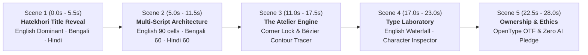

# Hatekhori (হাতে খড়ি · हातेखोड़ी) — Premium Product Launch Video

> Directed & authored with **HyperFrames by HeyGen**, deterministic GSAP motion choreography, camera perspective keyframes, and a custom acoustic piano & orchestral audio suite.

---

## 1. Executive Summary

| Attribute | Specification |
| :--- | :--- |
| **Duration** | 28.00 seconds (1,680 frames @ 60 FPS) |
| **Resolution** | 1920 × 1080 (Full HD, 16:9 Landscape) |
| **Language Hierarchy** | **English Dominant**, followed by **Bengali (বাংলা)**, followed by **Hindi (हिन्दी)** |
| **Framerate** | 60.0 FPS frame-accurate deterministic seek (`seek(t)`) |
| **Sound Design** | 28.0s Cinematic Acoustic Piano & String Soundtrack (108 BPM, Dm/Fmaj) + 7 tactile sound effects |
| **Typography** | `Instrument Serif` (Headings), `DM Mono` (Telemetry), `Hatekhori Latin`, `Hatekhori Bangla`, `Hatekhori Hindi` |
| **Brand Colors** | Deep Obsidian Slate (`#080808`), Chalk White (`#F0F0F0`), Vermilion Seal (`#D2271B`), Translucent Glass |

---

## 2. Narrative Arc & Language Hierarchy



### Scene 1: English Dominant Title Reveal (`0.0s – 5.5s`)
- **Visuals**: Deep obsidian slate canvas (`#080808`). The Atelier H emblem glows at center with volumetric chalk illumination.
  - **Hero Title**: **HATEKHORI** (Grand, architectural, `Instrument Serif` at 118px)
  - **Script Companion**: `হাতে খড়ি` (Bengali) `·` `हातेखोड़ी` (Hindi)
  - **Editorial Pitch**: *"Turn your real handwriting into an ownable, installable font."*
  - *"Named after the traditional slate ritual — drawing your very first letter in hand."*
- **Camera**: Gentle Ken Burns drift (`scale: 1.00 -> 1.05`, `y: 0 -> -12px`).
- **Sound Design**: Deep sub-bass boom (`sfx-sub-drop.wav`) at 0.1s, tactile chalk scrape (`sfx-chalk-stroke.wav`) at 1.2s.

### Scene 2: Multi-Script Architecture (`5.0s – 11.5s`)
- **Visuals**: *"English dominant. Bengali & Hindi native."*
  - Floating 3D perspective card deck with the English card featured center-stage:
    1. **English (Latin · 90 Cells)** — Hero elevated card (A–Z, a–z, 0–9, Punctuation).
    2. **বাংলা (Bengali · 60 Cells)** — Tilted left card (base consonants, matras, conjuncts).
    3. **हिन्दी (Devanagari · 60 Cells)** — Tilted right card (consonants, matras, shirorekha).
- **Camera**: Cinematic horizontal pan across the 3D card deck.
- **Sound Design**: Transition whoosh at 4.8s, tactile acoustic taps (`sfx-card-pop.wav`) at 5.6s, 6.2s, 6.8s.

### Scene 3: The Atelier Engine & Ingest (`11.0s – 17.5s`)
- **Visuals**: Dual-view luxury workbench:
  - **Left**: Optical scanner with EXIF scrubbing and 4 vermilion targets (`#D2271B`) locking perspective.
  - **Right**: Bézier contour tracer showing dual Latin `'H'` and Bengali `'অ'` vectorizing with 38 anchor nodes.
- **Sound Design**: Whoosh at 10.8s, precision mechanical shutter click at 12.8s, crystal completion chime at 14.2s.

### Scene 4: Live Typographic Laboratory (`17.0s – 23.0s`)
- **Visuals**: Editorial type specimen with English dominant optical scale waterfall:
  - `52px`: **"The quiet dignity of human handwriting."** (English Dominant)
  - `36px`: **"আমাদের নিজস্ব হাতে লেখা বর্ণমালা"** (Bengali)
  - `24px`: **"हाथ से लिखे अक्षरों का सजीव डिजिटल स्वरूप"** (Hindi)
  - `14px`: `UNICODE 15.0 COMPLIANT · OPENTYPE GSUB LOOKUPS`
  - Dynamic 1.58× camera punch-in to the Glyph Inspector (`U+0048 'H'` and `U+0995 'ক'`).
- **Sound Design**: Micro quartz ticks at 18.0s, 18.6s, 19.4s.

### Scene 5: Ownership, Ethics & Climax (`22.5s – 28.0s`)
- **Visuals**:
  - Climax statement: *"Your handwriting is your personal heritage. Own it forever."*
  - Three frosted glass pillar cards: **Zero AI Training**, **OpenType (.OTF)**, **100% Open Source**.
  - Grand lockup: **HATEKHORI** / `হাতে খড়ি` / `हातेखोड़ी` with `hatekhori.org`.
- **Camera**: Majestic pull-back to resolution.
- **Sound Design**: Grand piano resolution chord, card reveal tap, ambient tail fade.

---

## 3. Interactive HyperFrames Player Controls

Open [`launch-video/index.html`](file:///c:/Users/Administrator/Hatekhori/launch-video/index.html) in any browser:

| Control | Shortcut / Action | Function |
| :--- | :--- | :--- |
| **Play / Pause** | `Spacebar` / Click Button | Toggles live playback with synchronized audio |
| **Scrubber** | Drag slider | Deterministically seeks playhead to exact second and frame |
| **Step 1 Frame** | `←` / `→` Arrow keys | Moves playhead forward / backward by exactly 1/60th second |
| **Jump 1 Second** | `Shift + ←` / `Shift + →` | Fast scrub backward / forward by 1.0 second |
| **Jump to Scene** | Number keys `1` to `5` | Instantly seeks to Scene 1 (0s), Scene 2 (5.2s), Scene 3 (11.2s), Scene 4 (17.2s), Scene 5 (22.5s) |
| **Audio Sync** | Mute / Unmute Button | Toggles master audio suite playback |
| **Speed** | Dropdown | 0.5× (Slow motion review), 1.0× (Normal), 1.5×, 2.0× |
| **Auto Fit** | Fit 1080p Button | Dynamically scales the 1920×1080 stage to fit any screen |

---

## 4. CLI Execution & Rendering

### Live Preview Server
```bash
npx hyperframes preview --port 3000 --open
```

### Validate Timeline & Assets
```bash
python scripts/check_timeline.py
```

### Render 60 FPS Master Video
```bash
npx hyperframes render --output dist/hatekhori-launch-60fps.mp4 --fps 60 --quality high --chroma-subsampling 444
```
